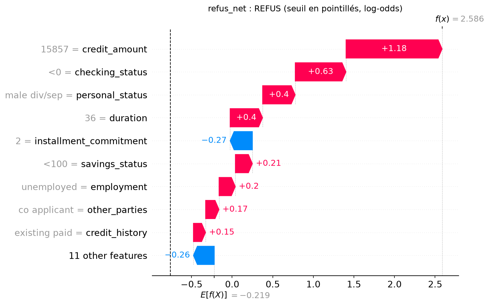
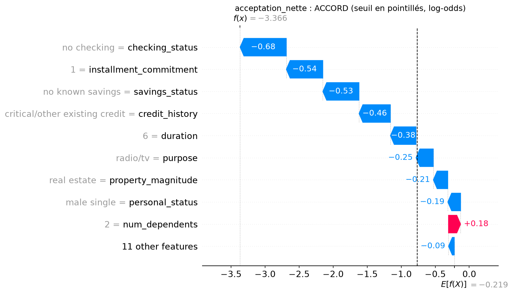
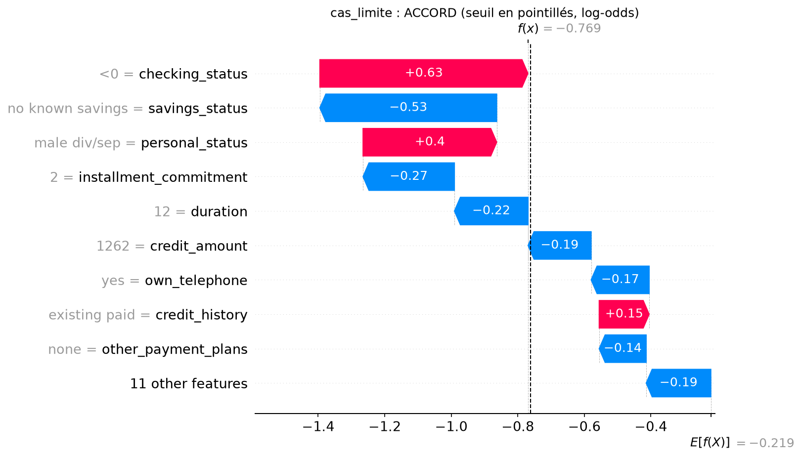

# Explications individuelles — german-credit, modèle v3

Seuil de refus : P(bad) >= 0.318.

## refus_net — demande 819 : P(bad) = 0.930 → REFUS

Principaux motifs défavorables :

- credit_amount = 15857 (+1.18)
- checking_status = <0 (+0.63)
- personal_status = male div/sep (+0.40) [attribut sensible]

Principaux éléments favorables :

- installment_commitment = 2 (-0.27)
- other_payment_plans = none (-0.14)
- purpose = other (-0.13)

Test contrefactuel (un seul attribut sensible modifié) : aucun.

## acceptation_nette — demande 160 : P(bad) = 0.033 → ACCORD

Principaux motifs défavorables :

- num_dependents = 2 (+0.18)
- own_telephone = none (+0.12)
- existing_credits = 2 (+0.07)

Principaux éléments favorables :

- checking_status = no checking (-0.68)
- installment_commitment = 1 (-0.54)
- savings_status = no known savings (-0.53)

Test contrefactuel (un seul attribut sensible modifié) : aucun.

## cas_limite — demande 278 : P(bad) = 0.317 → ACCORD

Principaux motifs défavorables :

- checking_status = <0 (+0.63)
- personal_status = male div/sep (+0.40) [attribut sensible]
- credit_history = existing paid (+0.15)

Principaux éléments favorables :

- savings_status = no known savings (-0.53)
- installment_commitment = 2 (-0.27)
- duration = 12 (-0.22)

Test contrefactuel (un seul attribut sensible modifié) : age -> <25.

